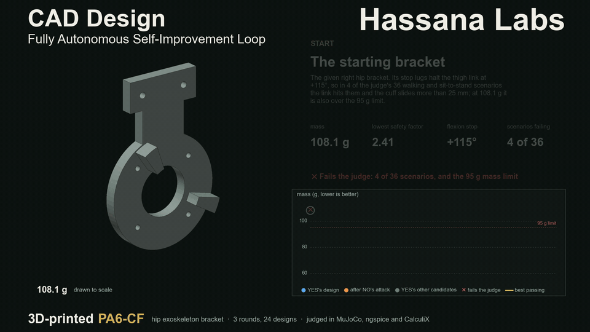
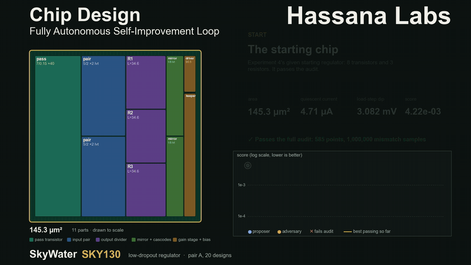

<div align="center">

<h1>debateRL</h1>

<b>Two AI agents argue over a hardware design. The judge reads no arguments: it builds the part and runs the physics.</b>

by Hassana Labs

<h3>

[How it works](#how-it-works) | [Install](#install) | [Quick start](#quick-start) | [Problems](#problems) | [Citation](#citation)

</h3>

[](LICENSE)
[](pyproject.toml)
[](#how-it-works)

</div>

<table>
<tr>
<td width="50%"></td>
<td width="50%"></td>
</tr>
<tr>
<td align="center"><b>CAD:</b> hip-exoskeleton bracket, 3 rounds, 24 designs</td>
<td align="center"><b>Chip:</b> SKY130 low-dropout regulator, same method, 20 designs</td>
</tr>
</table>

---

## How it works

- **YES** changes the design. **NO** attacks the change with up to 5 scenarios inside agreed ranges.
- The judge rebuilds the part and runs every scenario through real simulators, so a failure either reproduces or it doesn't.
- A change is accepted only if it passes every claim on the judge's grid, its motive is two-sided (a claim instance that
  fails on the baseline and holds on the change), and none of NO's scenarios reproduces a failure.

| stage | tool | what it settles |
|---|---|---|
| geometry | build123d / OpenCASCADE | one valid solid, printer fit, keep-outs, interfaces, hard stops, mass |
| motion | MuJoCo | the loads on the part while the wearer walks or stands up from a chair, across body sizes |
| drive | ngspice | the torque the motor drive actually delivers (battery sag, current loop, back-EMF) |
| stress | gmsh + CalculiX | six unit load cases on quadratic tets, superposed over the load history |

## Install

```sh
apt install calculix-ccx ngspice     # ccx and ngspice on the PATH
pip install -e .
debaterl validate                    # FEA against closed-form answers
```

The repository root is the `debaterl` package, so it runs once installed.

## Quick start

```sh
debaterl hip geometry design.py                   # scenario-free claims, mass, stop angles (~10 s)
debaterl hip check design.py                      # every claim on the 36-scenario grid
debaterl hip run design.py scenarios.json         # a list of scenarios (an attack)
debaterl hip motive baseline.py design.py m.json  # two-sided test of a change
debaterl hip contact design.py                    # push-only belt clamp at the three hardest moves (slow)
debaterl actuator check spec.json

debaterl debate hip start RUN                     # then yes, judge-yes, no, judge-no for each round
```

Output is JSON. Runs are deterministic: gmsh and CalculiX run single-threaded per process, and an FEA solve runs six
CalculiX processes of about 1 GB each.

| variable | default | |
|---|---|---|
| `DEBATERL_CACHE` | `~/.cache/debaterl` | results cached by design file hash |
| `DEBATERL_WORKERS` | CPU count | parallel judge processes |
| `DEBATERL_HOST` | unset | ssh destination: judge commands run there |
| `DEBATERL_REMOTE_PYTHON` | `~/debateRL/.venv/bin/python` | Python on that host, with the package installed |

## Problems

### Hip exoskeleton (`cad/`)

Two judges: `hip`, a hip-exoskeleton bracket as build123d code, and `actuator`, the hip actuator as five numbers on the
final bracket. `cad/hip_claims.json` is the contract: every claim and threshold, the scenario ranges, the model settings
a challenger may change, the judge's grid, and what is not covered.

`debaterl debate` builds each round's messages only from protocol fields (the baseline, the judge's verdicts, the motive
check, judge-confirmed attacks) and snapshots both sides' files before judging them. Launching the agents is up to you.

### Op-amp (`chip/`)

Size a fixed two-stage Miller op-amp (15 numbers) for the smallest area that meets a PVT spec and keeps |offset| <= 3 mV
over a million mismatch seeds, in ngspice. `chip/debate.py` runs the agents itself through the Anthropic API, one bash
shell each: debaters A and B design, attack each other's design with failing operating points or seeds, revise and
attack again, while solo designers work alone for comparison.

```sh
debaterl chip debate --out runs/chip1 [--solo 2]  # needs ANTHROPIC_API_KEY
debaterl chip judge design.json [--attack a.json]
debaterl chip sim design.json --process SS --temp 125 --vdd 1.7
```

The judge builds the one-million-seed mismatch table in `DEBATERL_CACHE` on first use.

## Layout

```
__main__.py        the debaterl command; ssh runner
helpers.py         settings, design build cache, B-rep helpers, gait curves, parallel cached runs
cad/
  fem.py           linear FEA: gmsh tet10 mesh, CalculiX unit cases, superposition, rigid seat fit
  debate.py        the YES/NO protocol: rules, round messages, judge steps, ledger
  hip_geom.py      bracket geometry claims, stop angles, mass
  hip_body.py      MuJoCo wearer and hip exo
  hip_drive.py     ngspice motor drive
  hip_motor.py     actuator model: five numbers to R, L, inertia, gearing, mass
  hip_judge.py     bracket judge
  hip_actuator.py  actuator judge
  hip_contact.py   push-only belt clamp check
  hip_bracket.py   the final bracket (design file the actuator judge uses)
  hip_claims.json  the contract
chip/
  sim.py           op-amp netlist and device model: one operating point, or the offset of one mismatch seed
  judge.py         105-point PVT grid, million-seed offset screen, attacks
  debate.py        agent harness (Anthropic API, bash): two debaters plus solo designers
```

## Citation

```bibtex
@software{debaterl2026,
  author = {{Hassana Labs}},
  title  = {debateRL: physics judges for design debates between AI agents},
  year   = {2026},
  url    = {https://github.com/leochlon/debateRL}
}
```

## License

CC BY-NC 4.0 (`LICENSE`): free to use and adapt for non-commercial purposes, with attribution to Hassana Labs.
Commercial use is not permitted.
